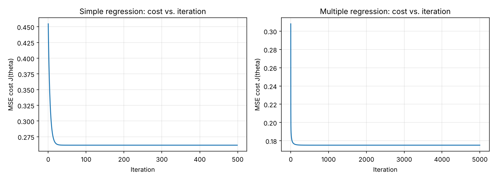
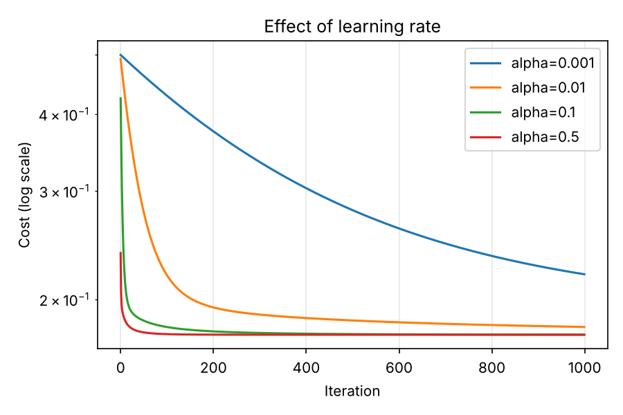

# Linear Regression from Scratch (NumPy only)

Linear regression built with nothing but NumPy: the hypothesis, the MSE cost, the gradient, and the gradient-descent loop are all written by hand. scikit-learn is used **only** for the train/test split and for a final sanity-check comparison. It is never used inside the model.

**Dataset:** California Housing (20,640 districts, target = `median_house_value`).

## Files

| File | Purpose |
|---|---|
| `linreg.py` | `LinearRegressionGD` class, plus manual `mse` and `r2_score_manual` |
| `train.py` | Loads data, preprocesses, trains simple + multiple regression, plots, compares with sklearn |
| `cost_convergence.png` | Cost vs. iteration (proof of convergence) |
| `learning_rates.png` | Cost curves for several learning rates |
| `simple_fit.png` | Fitted line for the single-feature model |
| `run_output.txt` | Full console output of the final run |

Run it: `pip install -r requirements.txt && python train.py`

## The math

**Hypothesis.** Put a column of ones in front of the feature matrix `X` (so the intercept is just another weight). The prediction for all `m` examples at once is a matrix product:

```
h(X) = X θ
```

**Cost (MSE).** How wrong are we on average? Take each error `h − y`, square it so over- and under-predictions both count and big misses are punished more, and average:

```
J(θ) = (1 / 2m) · Σ (Xθ − y)²
```

The extra `1/2` is only there so it cancels the `2` that appears when we differentiate.

**Gradient.** Differentiating `J` with respect to `θ`: the square brings down a 2, and the chain rule multiplies by `X`:

```
∂J/∂θ = (1/m) · Xᵀ (Xθ − y)
```

Each entry says how much the cost changes if that weight is nudged up. The cost is a bowl-shaped (convex) function of `θ`, so there is one minimum and following the slope downhill finds it.

**Gradient descent.** Repeatedly step opposite the gradient, by a size set by the learning rate α:

```
θ := θ − α · (1/m) · Xᵀ (Xθ − y)
```

The cost is stored every iteration, which gives the convergence plot.

**Evaluation metrics (computed manually):**

```
MSE = mean((y − ŷ)²)
R²  = 1 − Σ(y − ŷ)² / Σ(y − ȳ)²
```

## Preprocessing

- `total_bedrooms` has 207 missing values, filled with the **training-set median**.
- `ocean_proximity` (categorical) is one-hot encoded, giving 12 features in total.
- Features are standardized (z-score) using **training-set** mean and std only, so nothing leaks from the test set. The target is standardized the same way so the cost is O(1) and one learning rate works well. Predictions are converted back to dollars before computing MSE and R².
- 80/20 train/test split, `random_state=42`.

## Results (test set, 4,128 examples)

| Model | Implementation | MSE | R² |
|---|---|---|---|
| Simple (`median_income` only) | From scratch | 7,091,157,771.77 | 0.458859 |
| Simple (`median_income` only) | scikit-learn | 7,091,157,771.77 | 0.458859 |
| Multiple (12 features) | From scratch | 4,908,290,571.31 | 0.625438 |
| Multiple (12 features) | scikit-learn | 4,908,290,571.35 | 0.625438 |

**Correctness check:** the largest difference between my coefficients and sklearn's is `3.3e-16` (simple) and `6.4e-11` (multiple), in standardized space. The from-scratch model reproduces the closed-form solution.

Multiple-regression coefficients (standardized features):

| Feature | From scratch | sklearn |
|---|---|---|
| longitude | -0.46555 | -0.46555 |
| latitude | -0.47065 | -0.47065 |
| housing_median_age | 0.12013 | 0.12013 |
| total_rooms | -0.11325 | -0.11325 |
| total_bedrooms | 0.37250 | 0.37250 |
| population | -0.37540 | -0.37540 |
| households | 0.15899 | 0.15899 |
| median_income | 0.65013 | 0.65013 |
| ocean_proximity_INLAND | -0.16006 | -0.16006 |
| ocean_proximity_ISLAND | 0.01832 | 0.01832 |
| ocean_proximity_NEAR BAY | -0.01403 | -0.01403 |
| ocean_proximity_NEAR OCEAN | 0.00986 | 0.00986 |




## Notes and lessons

- **Learning rate:** with standardized features, α = 0.1 to 0.5 converges smoothly; α = 0.001 is still far from converged after 1000 iterations (see `learning_rates.png`).
- **Iterations matter with correlated features:** my first multiple-regression run (α = 0.1, 1000 iterations) had a good-looking cost curve but coefficients still off by ~0.04 versus sklearn. `total_rooms`, `total_bedrooms`, `households` and `population` are highly correlated, which makes the cost surface a long narrow valley where gradient descent crawls along the flat direction. Raising α to 0.3 and running 5000 iterations closed the gap. A flat cost curve does not by itself prove the parameters have converged, which is why the sklearn comparison is worth doing.
- R² is about 0.63 because linear regression cannot capture the non-linear geography effects and because `median_house_value` is capped at $500k in this dataset.
